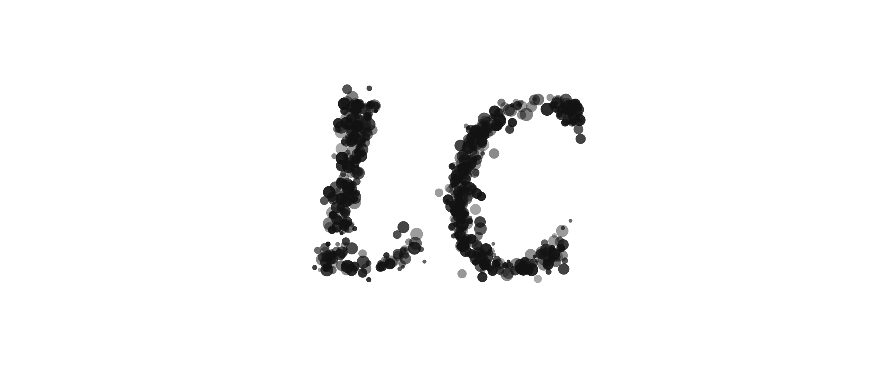

# metalc



MetaLC implement a robust mixed-membership model and lets domain knowledge
into the loop: ensemble topics are pooled and clustered into stable
**meta-LCs**, which you then use to build a model that describes your data.

## Install

```bash
pip install metalc
```

## Usage

```python
import metalc as mlc
```

### 1. Fit an ensemble

Supports LDA and NMF.

```python
ensemble = mlc.run_ensemble(df, [2, 10], method="lda",
                            taxonomy=taxa_df,      # feature-indexed; annotation only
                            cache_dir=".../lda_ensemble_results")
```

### 2. Select a layer and look at it

```python
ensemble.layers()
e = ensemble[2]

mlc.plot_meta(e, view="profile", rank="Genus", profile="medoid", coherence=True)
mlc.plot_meta(e, view="umap",    rank="Genus", profile="medoid")
```

### 3. Freeze the meta-LCs and infer H

```python
result = mlc.inference(e, metadata, meta_lc_list=[0, 3, 4], profile="medoid")
result.H   # samples x meta-LC, rows sum to 1
result.W   # meta-LC x feature (the frozen dictionary)
```
